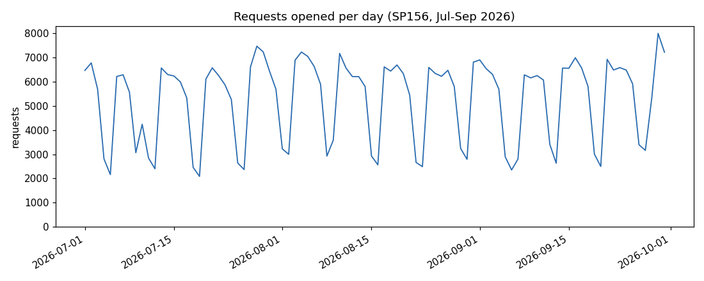

# SP156 service requests: SQL and Python analysis

A small, reproducible analysis of public customer-service data: about 484,000 requests that citizens opened with the city of São Paulo's 156 service between July and September 2026. The pipeline downloads the file, cleans it, loads it into SQLite, runs eight SQL queries, draws charts and writes a short report.

> Built with AI assistance, reviewed by me. I am a first-semester computer science student; this is a study project, not professional experience. The numbers come from queries you can run, and the report lists what they cannot tell.

## What you get

- `reports/relatorio.md`: five findings in plain language, each pointing to the SQL query and the chart behind it.
- `reports/*.png`: six charts. `reports/tables/*.csv`: the result of every query.
- `sql/`: the schema and 8 queries (volume by month, by day, by theme; top subjects; time to close; backlog; weekday pattern; channels).

Some of what the report says (see it for the exact numbers): about 161 thousand requests per month; four themes hold 58% of the volume; weekends have under half of a weekday's requests; the time to close ranges from the same day to about three weeks depending on the theme; and one theme ("Rua e bairro") holds the largest backlog.



## Run it

Python 3.9 or newer.

```bash
python3 -m venv .venv && .venv/bin/pip install -r requirements.txt
.venv/bin/python -m pipeline.run          # downloads about 105 MB once, then runs everything
.venv/bin/python -m pytest                # tests of the cleaning step
```

No internet, or just want a quick look? Use the 20,000-row sample kept in the repository (about 3.6 MB). Results go to `outputs_sample/`, so the committed report is not overwritten, and the counts are about 4% of the real ones:

```bash
.venv/bin/python -m pipeline.run --sample
```

## How it works

```
download (urllib) -> clean (pandas) -> load (sqlite3) -> 8 SQL queries -> charts (matplotlib) -> report
```

| Step | File | What it does |
|---|---|---|
| download | `pipeline/download.py` | Saves the CSV in `data/raw/` (ignored by git) |
| clean | `pipeline/clean.py` | Parses dates (month/day/year), normalises status, removes test records, drops impossible closing dates, computes days to close |
| load | `pipeline/load.py`, `sql/schema.sql` | One table, `requests`, in a local SQLite file |
| query | `sql/01_*.sql` ... `sql/08_*.sql` | Each file is one question; results in `reports/tables/` |
| charts, report | `pipeline/charts.py`, `pipeline/report.py` | The report text is fixed, but every number is filled in from the query results |

## Data

SP156 open data, Prefeitura de São Paulo, Portal de Dados Abertos: <https://dados.prefeitura.sp.gov.br/dataset/dados-do-sp156>. License on the official page: Creative Commons CCZero (CC0). Details in [`DATA_LICENSE.md`](DATA_LICENSE.md). This project is not affiliated with the city hall.

Privacy: the project never reads street, number, ZIP code or coordinates, and the sample in the repository does not contain them.

## Limits

- Status is a snapshot from when the city published the file. "Backlog" means "not closed in that snapshot".
- Time to close only counts closed requests, so it looks shorter than reality for slow themes and for the newest weeks.
- Many requests are not many problems: one problem can be reported several times.
- The file has dates but no time of day, so there is no analysis by hour.
- One quarter only, so no yearly seasonality.
- Tested on macOS with Python 3.9 and pandas 2.x; other setups were not tested.

## Em português (resumo)

Análise com SQL e Python de cerca de 484 mil solicitações do SP156 (Prefeitura de São Paulo, dados abertos, licença CC0) do 3º trimestre de 2026. O pipeline baixa o arquivo, limpa, carrega no SQLite, roda 8 consultas, gera gráficos e um relatório com 5 achados, cada um apontando para a consulta que o produziu. Feito com apoio de IA e revisado por mim; é um projeto de estudo, não experiência profissional. Para rodar: os três comandos acima (ou `--sample` para a amostra pequena, sem internet).

## License

Code: MIT (`LICENSE`). Data: CC0, see `DATA_LICENSE.md`.
