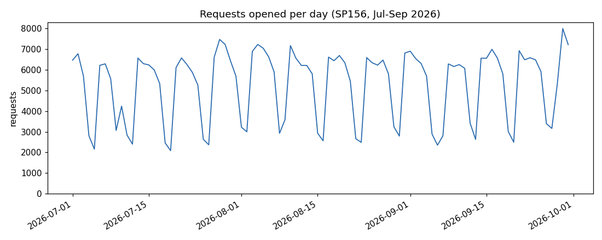
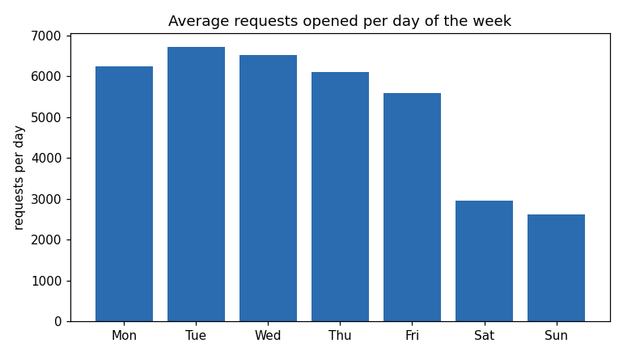
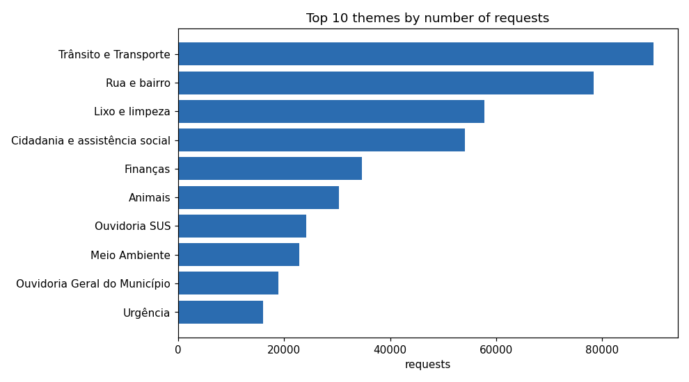
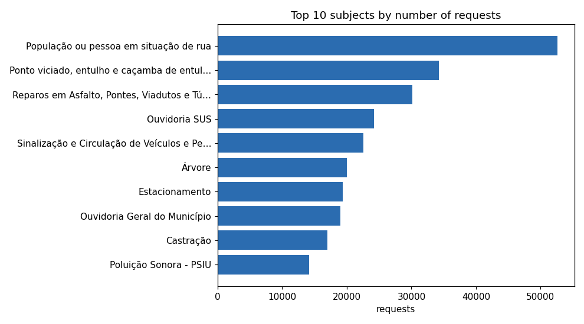
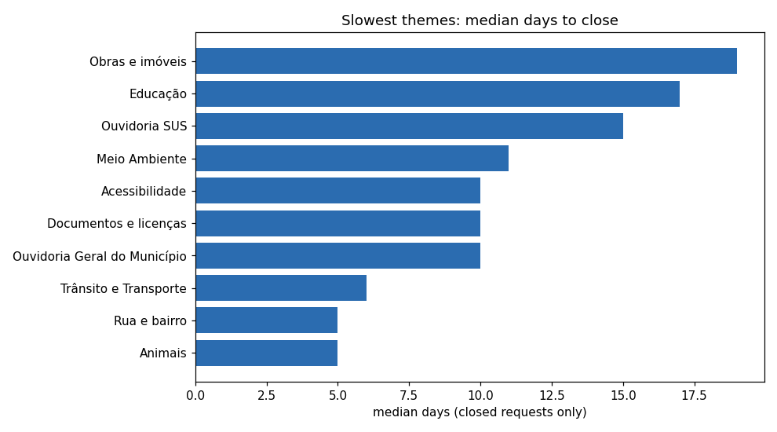
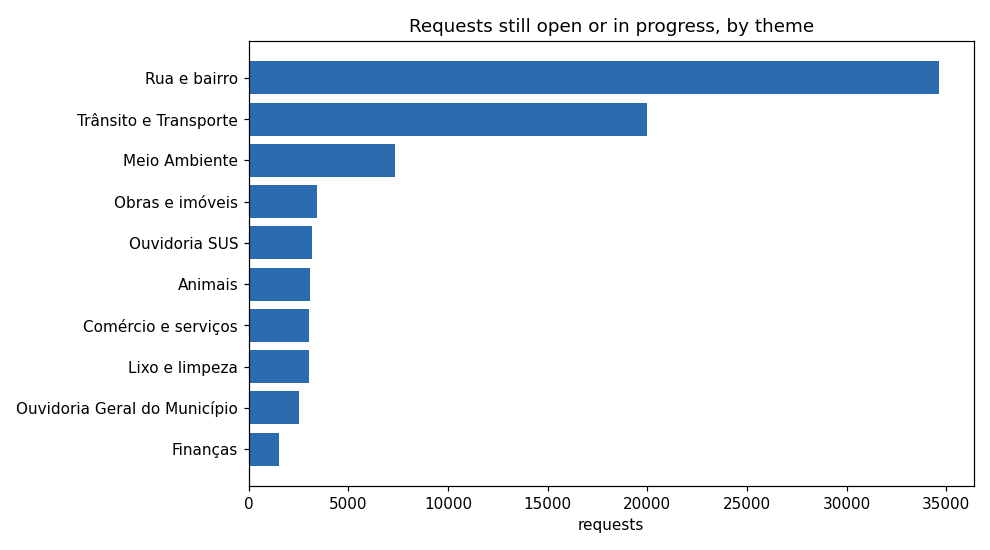

# SP156 requests, July to September 2026: what the data says

Source: SP156 open data (São Paulo city hall), requests opened in the 3rd quarter of 2026.
After cleaning, 484,047 requests (185 test records removed).
Every number below comes from a query in `sql/`; the result of each query is saved in `reports/tables/`.
Read the "Limits" section before quoting any of these numbers.

## 1. About 161 thousand requests arrive every month, and the share closed drops for the newest month

- Total in the quarter: 484,047. Per month: 2026-07 = 157,821, 2026-08 = 164,650, 2026-09 = 161,576.
- The closed share goes from 87.8% (2026-07) to 73.5% (2026-09).
  A likely reason is timing: newer requests have had less time to be closed (my reading;
  the data alone cannot prove it). It should not be read as the service getting worse.
- Query: `sql/01_volume_by_month.sql`. Chart: `reports/01_requests_per_day.png`.

## 2. Requests follow the work week

- Monday to Friday average 5,581 to 6,717 requests per day; Saturday and Sunday average 2,788
  (about 45% of a weekday).
- Friday is the lowest weekday on average (5,581 per day).
- The lowest weekday of the quarter was 2026-09-07 with 2,803 requests (September 7 is Independence Day, a national holiday in Brazil; that explanation is mine, the data only shows the drop).
- Queries: `sql/07_weekday_pattern.sql` and `sql/02_volume_by_day.sql`. Charts: `reports/06_weekday.png`, `reports/01_requests_per_day.png`.

- The file only has dates, with no time of day, so a pattern by hour cannot be checked.

## 3. A few themes account for most of the volume

- The 4 biggest themes (Trânsito e Transporte, Rua e bairro, Lixo e limpeza, Cidadania e assistência social) hold 57.8% of all requests.
- The single most frequent subject is "População ou pessoa em situação de rua" with 52,585 requests
  (10.9% of the total), under the theme "Cidadania e assistência social".
- Queries: `sql/03_volume_by_theme.sql` and `sql/04_top_subjects.sql`. Charts: `reports/02_top_themes.png`, `reports/03_top_subjects.png`.

## 4. Time to close varies a lot by theme

- Among closed requests, the median is 0 day(s) for "Cidadania e assistência social" and
  19 days for "Obras e imóveis" (only 580 closed requests, so treat with care).
- Among the larger half of themes (at least 15,460 closed requests), the slowest median is "Ouvidoria SUS":
  15 days (90% of them closed within 30 days).
- Query: `sql/05_time_to_close_by_theme.sql`. Chart: `reports/04_time_to_close.png`.

- Median is used instead of average because a few very slow requests pull the average up.

## 5. The backlog is concentrated in a few themes

- "Rua e bairro" has the biggest backlog: 34,635 requests still open or in progress
  (44.2% of its requests), on average 39 days old at the end of the quarter.
- The highest backlog share is "Comércio e serviços": 87.3% of its 3,463 requests.
- Query: `sql/06_backlog_by_theme.sql`. Chart: `reports/05_backlog.png`.

## Extra: channels

- PORTAL is the biggest channel (47.5% of requests), then
  CRM (32.0%) and MOBILE (13.5%).
  Query: `sql/08_channel_mix.sql`. The file does not explain the channel codes `CRM` and `INTEGRACAO`, so they are shown as they are.

## Limits

- Status is a snapshot from when the city published the file, not the state on the last day of the quarter.
  "Backlog" here means "not closed in the snapshot".
- Time to close only counts requests that are closed. Requests still open are left out, so times look shorter
  than reality, mainly for slow themes and for the newest weeks.
- 3,975 requests are marked closed but have no closing date. They count as closed
  in shares but not in days to close.
- One row is one request, but one citizen can open several requests for the same problem, and one problem can
  be reported by many people. The number of requests is not the number of problems in the city (the dataset glossary says the same).
- The raw file has no request id, so identical rows were kept. They may be real separate requests.
- Street, number, ZIP code and coordinates are not used by this project.
